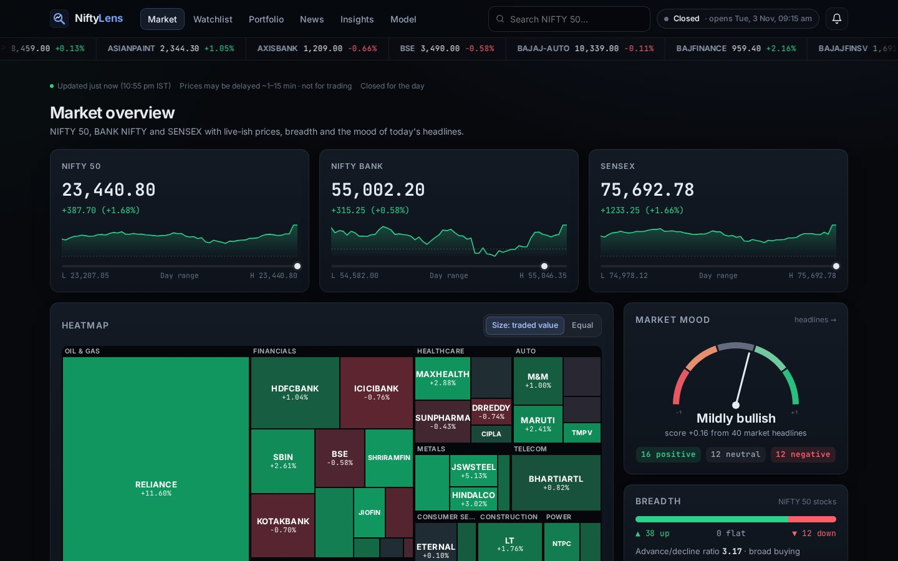
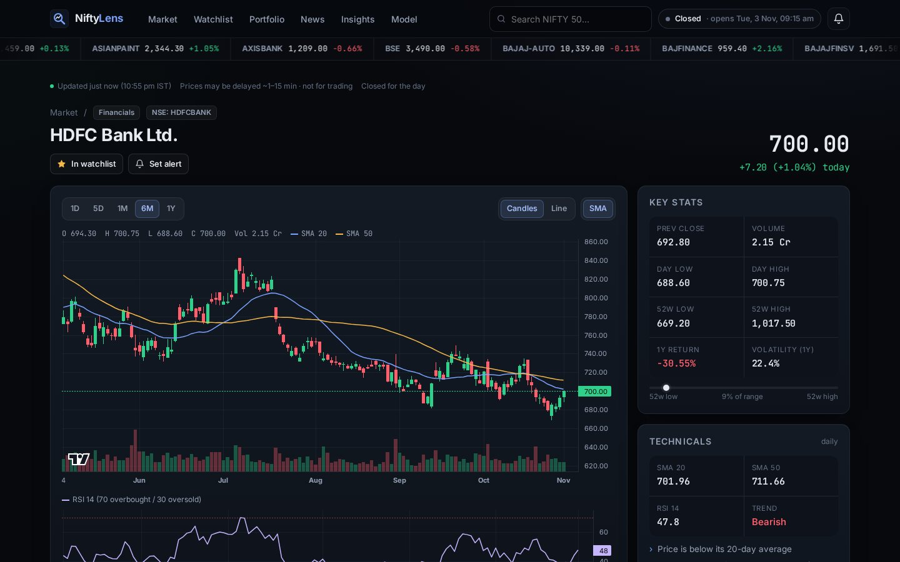
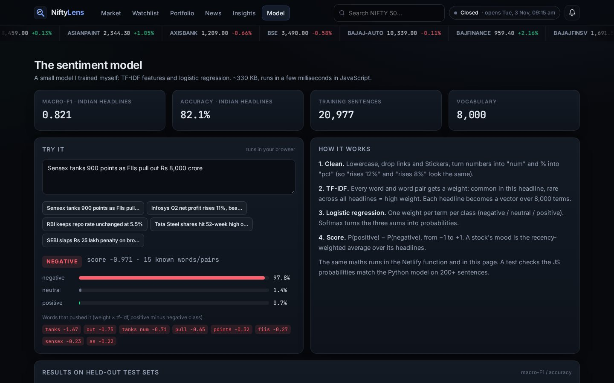
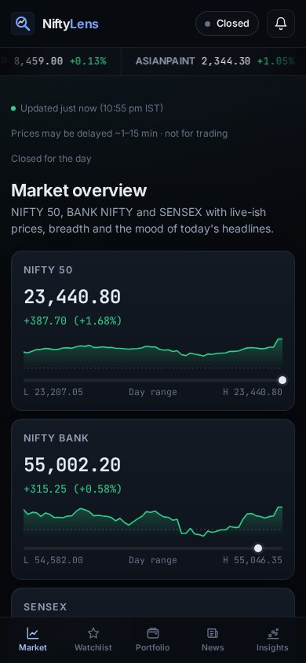
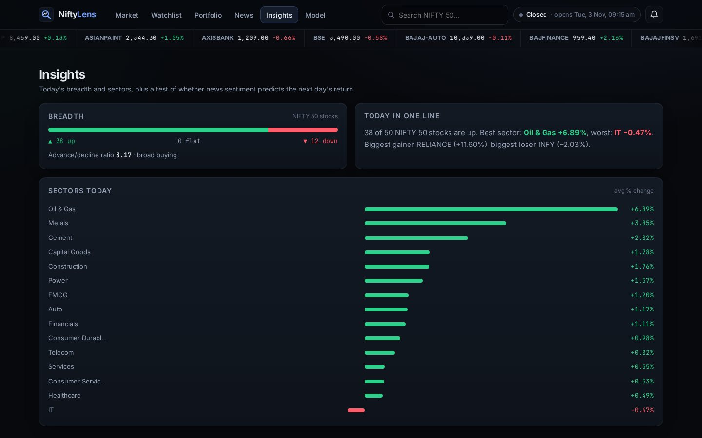

# NiftyLens

A dark, trading-terminal style dashboard for the NIFTY 50: live-ish prices, charts with indicators, a news sentiment model I trained myself, alerts, and a small study on whether news sentiment actually predicts next-day returns (spoiler: it doesn't).

**Live:** https://niftylens.netlify.app



I invest a bit and kept switching between 4 apps to check prices, read news and figure out if the news was good or bad. So I built one place for it, and used it as an excuse to train a real text model and test a claim I kept seeing online ("trade the news sentiment").

> Not investment advice. Prices come from public endpoints and are delayed (around 15 minutes for NSE). Don't trade off this.

## What it does

- **Overview**: NIFTY 50, BANK NIFTY and SENSEX cards, market status (IST hours + the NSE 2026 holiday list, including the Muhurat session), a sector heatmap (squarified treemap, sized by traded value or equal), breadth, top gainers/losers and a market mood gauge from the news.
- **Stock page**: candlestick chart with intraday, 1M, 6M and 1Y, volume, SMA 20/50 and RSI 14 in a synced pane, 52-week range, day stats, and that stock's headlines with a sentiment score, trend and a "why?" button that shows which words drove the score.
- **Watchlist** and **Portfolio** (P&L per holding and total, day's P&L) saved in localStorage. Nothing leaves your browser.
- **News**: market headlines from ET Markets, Mint and Business Standard, each labelled positive/neutral/negative.
- **Alerts**: price above/below, % move up/down, and "sentiment turns negative". They show as toasts and browser notifications (if you allow them). Alerts fire once and re-arm when the condition goes false again.
- **Insights**: today's breadth and sector performance, and the sentiment vs returns study below.
- **Model**: how the sentiment model works, a playground, test results and a confusion matrix.

Prices refresh every 30 s while the market is open (5 min when closed) and pause when the tab is hidden. Changed prices flash briefly (unless you have reduced motion turned on).

| Stock page | Model page | Mobile |
|---|---|---|
|  |  |  |

## How it's built

```
React (Vite) ──/api/*──> Netlify Functions ──> Yahoo Finance chart API (Moneycontrol as fallback)
                                          └──> Google News RSS + ET / Mint / BS RSS ──> sentiment model (JS)
```

- **Frontend**: React 18 + Vite, React Router, [lightweight-charts](https://github.com/tradingview/lightweight-charts) for the charts. Plain CSS, no UI library.
- **Functions** (`netlify/functions/`):
  - `quotes` fetches all 53 symbols in one go and caches them (30 s when open, 5 min when closed). Only whitelisted NIFTY 50 / index symbols are accepted.
  - `chart` gives candles for 1d to 5y. If Yahoo fails it falls back to Moneycontrol's chart API.
  - `news` pulls RSS, filters out headlines that don't actually mention the company, dedupes, and scores everything with the model. Cached 10 min.
  - Responses also set `Netlify-CDN-Cache-Control`, so most requests never hit the upstream sites.
- **When things fail**: the client falls back to the last good response in localStorage, and if that's missing too, to a recorded sample snapshot in `public/sample/` (shown with a clear "sample data" banner). `node scripts/record-sample.mjs` refreshes the snapshot.

## The sentiment model

TF-IDF (words + word pairs, 8,000 features) and logistic regression, trained in Python with scikit-learn and exported to a JSON-ish JS file (~330 KB). The same maths runs in the function and in the browser. A test checks the JS output matches Python's probabilities.

Training data (20,977 sentences):

- [Financial PhraseBank](https://huggingface.co/datasets/takala/financial_phrasebank) (Malo et al. 2014, CC BY-NC-SA 3.0), 50% agreement version
- [SEntFiN 1.0](https://github.com/pyRis/SEntFiN) (Sinha et al. 2022, MIT), Indian financial headlines
- [Twitter Financial News Sentiment](https://huggingface.co/datasets/zeroshot/twitter-financial-news-sentiment) (MIT)

Results on held-out test sets (macro-F1, accuracy in brackets):

| Model | SEntFiN (Indian, n=1891) | PhraseBank (n=968) | Twitter (n=2388) |
|---|---|---|---|
| Always "neutral" | 0.177 | 0.248 | 0.264 |
| Naive Bayes | 0.787 | 0.650 | 0.740 |
| Linear SVM | 0.828 | 0.730 | 0.771 |
| **Logistic regression (used)** | **0.821** (82.1%) | **0.720** (76.2%) | **0.760** (81.6%) |
| Logistic regression without SEntFiN | 0.671 | 0.712 | 0.756 |
| FinBERT, zero-shot | 0.716 (71.3%) | not scored* | 0.669 (72.6%) |

\* FinBERT was trained on PhraseBank, so scoring it there would be unfair. It's also not a fair fight the other way: my model saw the SEntFiN and Twitter training splits and FinBERT didn't. The point is just that a small in-domain model is good enough here at about 1/300th of the size.

The SVM is slightly better but I went with logistic regression because I need probabilities for the score (P(positive) − P(negative)). Adding the Indian headlines was the single biggest improvement (+0.15 macro-F1 on Indian news).

## Does sentiment predict returns?

I collected 17,172 headlines about NIFTY 50 stocks from Google News (6 Jul to 30 Oct 2026), scored them, averaged per stock per day (2,310 stock-days with 2+ headlines) and lined them up with daily returns minus the NIFTY 50's return.

- **Same day**: correlation 0.32 (p < 0.001). Negative-news days averaged −0.94% vs the index, positive ones +0.40%.
- **Next day**: correlation 0.0015 (p = 0.94). Direction hit rate 47.7% on 1,457 days, which is a coin flip.

So the news mostly describes moves that already happened. By the time a headline is out, large caps have priced it in. Caveats: 4 months of data, Google News only returns a sample, and timestamps aren't precise. Code is in `analysis/`.



## Running it

```bash
npm ci
npm run dev          # frontend only; uses the sample snapshot for data
npx netlify dev      # frontend + functions with live data
npm test             # vitest: indicators, market hours, sentiment parity, alerts, treemap
npm run test:fn      # function tests (mocked); LIVE=1 npm run test:fn hits the real APIs
npm run build
```

Retraining the model:

```bash
cd ml
python -m venv venv && source venv/bin/activate
pip install -r requirements.txt
python get_data.py
python train_sentiment.py     # writes shared/sentiment-model.js and ml/results/
python compare_finbert.py     # optional, needs torch + transformers
cd ../analysis
python collect_headlines.py   # ~20 min, polite delays between requests
python sentiment_vs_returns.py
```

## Things I'd improve

- Prices are delayed and from an unofficial endpoint. A proper broker API (Kite Connect etc.) would give real-time ticks, but needs a paid account.
- Alerts only run while the tab is open. Real push alerts would need a backend job + Web Push.
- Heatmap uses traded value instead of market cap because I couldn't find a free, reliable market cap source.
- The model reads words, not meaning: "losses narrow" or sarcasm can fool it. Fine-tuning a small transformer on SEntFiN would be the next step.
- The returns study needs more history and intraday prices to be convincing either way.

## Credits

Market data from Yahoo Finance and Moneycontrol (public endpoints, for personal/educational use). News via Google News and publisher RSS feeds, headlines link to the original articles. Holiday list from NSE. Charts by TradingView's lightweight-charts (Apache 2.0).
